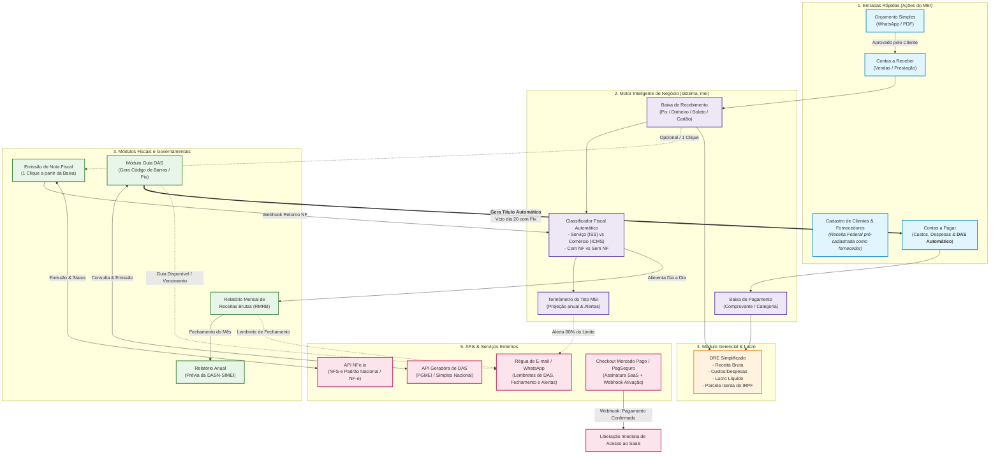
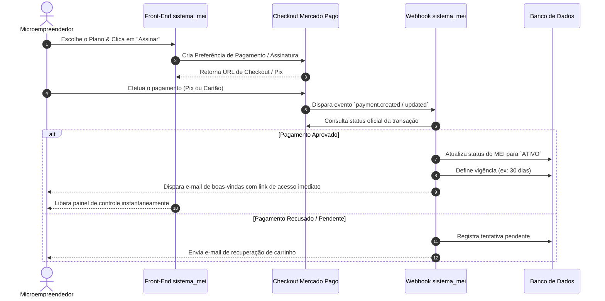

# Blueprint Executivo: Arquitetura & Fluxo de Dados — sistema_mei

> **Visão Geral:** Transformar ações simples do dia a dia do MEI (orçar, receber, pagar) em conformidade fiscal e contábil automática, sem burocracia e com custo operacional sustentável.

---

## 1. Visão do Contador: A Lógica de Negócio do MEI

O MEI possui regras simplificadas pela **Lei Complementar nº 123/2006** e **Resolução CGSN nº 140/2018**, mas com fiscalização eletrônica cada vez mais rigorosa (cruzamentos via DIMP, Pix e emissão eletrônica).

### O que o sistema deve fazer "por debaixo do capô":
1. **Segregação de Receita Bruta:** 
   - Receita de **Serviços** (sujeita a ISS)
   - Receita de **Comércio / Indústria** (sujeita a ICMS)
   - Com emissão de documento fiscal vs. Sem emissão de documento fiscal.
2. **Termômetro do Teto Anual:**
   - Limite atual de R$ 81.000,00/ano (ou R$ 6.750,00 proporcionais por mês de atividade).
   - *Regra em tramitação/atualização governamental:* Discussões do PLP 108/2021 (elevação de teto para ~R$ 130k a R$ 144k com rampa de transição) e Reforma Tributária do Consumo (IBS/CBS, mantendo o Simples/MEI simplificado, mas exigindo rastreabilidade digital).
   - O sistema deve alertar: **Zona Verde (< 70%)**, **Zona Amarela (70-80%)**, **Zona Laranja (80-100%)** e **Alerta Vermelho (> 100% - risco de desenquadramento retroativo)**.
3. **Obrigações Automatizadas:**
   - **RMRB (Relatório Mensal de Receitas Brutas):** Obrigatório por lei até o dia 20 do mês subsequente (Art. 106 da Res. CGSN 140/2018).
   - **DASN-SIMEI (Declaração Anual):** Entregue até 31 de maio. É o somatório exato dos 12 relatórios mensais fechados.
   - **Guia DAS (Documento de Arrecadação do Simples Nacional):** Vencimento todo dia 20 (INSS 5% do Salário Mínimo + R$ 1,00 ICMS comércio / R$ 5,00 ISS serviço).
   - **DRE Gerencial Simples:** Receita Bruta Recebida (-) Despesas Operacionais Pagas = Resultado Líquido. Essencial para o cálculo da **Parcela Isenta do IRPF** da Pessoa Física do MEI (8% comércio, 16% transporte passageiros, 32% serviços).

---

## 2. Fluxograma de Dados dos Módulos

---

## 3. Comportamento das Telas e Regras Governamentais

### A. Emissão de Nota Fiscal (Integração NFe.io)
* **Padrão Nacional de NFS-e:** Desde setembro de 2023, todos os MEIs prestadores de serviços são obrigados a emitir notas pelo Padrão Nacional. A NFe.io já suporta e unifica esse fluxo.
* **Tela de Configurações no sistema:**
  - **Identificação:** CNPJ, Razão Social, Nome Fantasia, Inscrição Municipal (se houver).
  - **Certificado Digital A1:** Upload do `.pfx` com senha criptografada (necessário para NF-e de mercadorias; para NFS-e padrão nacional, pode usar credencial/token do emissor nacional).
  - **Configurações Padrão:** O MEI não destaca ICMS/ISS da mesma forma que empresas normais. O sistema já pré-configura as alíquotas zeradas/regime especial MEI, CNAE principal e item da Lista de Serviços (LC 116/03), evitando que o MEI cometa erros de preenchimento.
* **Emissão a partir do Contas a Receber:** Ao dar baixa no recebimento, aparece o botão: *"Emitir NF deste recebimento"*. O sistema pré-carrega os dados do cliente e da venda, bastando 1 clique.

### B. Relatório Mensal de Receitas Brutas (RMRB)
* Toda vez que um contas a receber é baixado, o valor cai no mês correspondente do RMRB.
* O sistema separa automaticamente:
  1. Revenda de mercadorias (com e sem NF)
  2. Venda de produtos industrializados (com e sem NF)
  3. Prestação de serviços (com e sem NF)
* No final do mês, o sistema gera o PDF oficial do RMRB pronto para assinatura ou arquivo digital com os comprovantes.

### C. Relatório Anual (DASN-SIMEI)
* Conforme cada mês é finalizado, ele alimenta o acumulador anual.
* Em janeiro/fevereiro, quando o MEI precisa declarar, o sistema exibe os 3 campos exatos que a Receita Federal pede na declaração:
  1. Valor da receita bruta total de comércio, indústria e serviços de transporte intermunicipal e interestadual e de refeições;
  2. Valor da receita bruta total de prestações de serviços de qualquer natureza;
  3. Se possuiu ou não empregado no período.
* O MEI não precisa refazer contas no fim do ano: está tudo pronto.

### D. Emissão da Guia DAS & Integração Direta com Contas a Pagar
* **Fornecedor Padrão Automático no Onboarding:** No momento em que o MEI contrata ou ativa a conta, o sistema cria automaticamente no banco de dados o fornecedor do sistema:
  - **Nome:** *Receita Federal do Brasil (Simples Nacional - PGMEI)*
  - **Categoria Contábil:** *Impostos e Tributos Obrigatórios*
  - **Tipo de Despesa:** *Despesa Operacional Fixa*
* **Lançamento Automático no Contas a Pagar:**
  1. Entre os dias 01 e 05 de cada mês, a API do PGMEI consulta o DAS da competência atual.
  2. O sistema gera **automaticamente uma duplicata/título no Contas a Pagar**:
     - **Fornecedor:** Receita Federal do Brasil
     - **Descrição:** `Guia DAS-MEI - Competência MM/AAAA`
     - **Valor:** R$ [Valor exato retornado pela API, ex: R$ 75,60 ~ R$ 80,60]
     - **Vencimento:** Dia 20 (ou próximo dia útil bancário)
     - **Dados de Pagamento Embutidos:** Linha digitável, Chave Pix Copia e Cola e QR Code.
  3. Quando o MEI faz o pagamento e baixa a conta (ou a API confirma a liquidação), o status do mês no fiscal muda para **PAGO** e o valor impacta o fluxo de caixa no **DRE**.
  4. Caso não seja pago até o dia 15 ou 18, a **Régua de Lembretes** avisa por e-mail/WhatsApp: *"Sua guia DAS vence em breve no seu Contas a Pagar"*.

---

## 4. Engenharia de Custos e Viabilidade Financeira

Para precificar o SaaS de forma competitiva e lucrativa, levantamos a estrutura de custos por usuário e custos fixos:

### 1. Custos Variáveis (por cliente ativo / por consumo)
| Item | Fornecedor / Solução | Custo Estimado | Observações |
| :--- | :--- | :--- | :--- |
| **Emissão de Notas** | NFe.io | ~R$ 0,15 a R$ 0,40 / nota | MEI emite em média de 3 a 15 notas/mês. Custo médio: R$ 1,50 a R$ 3,00/usuário/mês |
| **Geração de DAS** | API Fiscal / Infosimples / Serpro | ~R$ 0,20 a R$ 0,50 / consulta | 1 geração por mês por MEI. Custo médio: ~R$ 0,40/mês |
| **E-mails Transacionais** | Resend / AWS SES | R$ 0,0005 por e-mail | Praticamente nulo (grátis até milhares de disparos) |
| **Gateway de Pagamento** | Mercado Pago / PagBank | 0,99% (Pix) a 3,99% (Cartão) | Cobrado apenas no momento da assinatura |

> **Custo Variável Total por MEI Ativo:** Aprox. **R$ 3,50 a R$ 5,50 / mês**.

### 2. Custos Fixos Mensais (Infraestrutura inicial para até 1.000 clientes)
| Componente | Provedor Recomendado | Custo Mensal Estimado |
| :--- | :--- | :--- |
| **Servidor Cloud (Backend + DB)** | Hetzner / DigitalOcean / AWS | R$ 80,00 – R$ 180,00 |
| **Banco de Dados Gerenciado / Backups** | Postgres Supabase / Neon / Local | R$ 0,00 (tier free) a R$ 150,00 |
| **Domínio + Segurança + SSL** | Cloudflare | R$ 0,00 (Free) |
| **Total Fixo Inicial:** | — | **~R$ 150,00 a R$ 300,00 / mês** |

### 3. Sugestão de Modelo de Cobrança (Pricing do SaaS)
Para o MEI, preços redondos e justos abaixo de R$ 50 geram adesão em massa com baixa taxa de cancelamento:

* **Plano Básico (Sem emissão de NF ou até 3 NFs/mês):** **R$ 19,90 / mês**
  - Cadastro, Orçamento, Contas a Pagar/Receber, RMRB automático e DAS com Pix.
* **Plano Profissional (Até 30 NFs/mês - Recomendado):** **R$ 39,90 / mês**
  - Tudo do básico + Emissão de Notas NFe.io + DASN anual pré-preenchida + DRE e régua de lembretes.
* **Margem Bruta Estimada:** **> 85% de margem**, cobrindo com folga servidores, marketing, suporte e lucro dos sócios.

---

## 5. Checkout e Regra de Liberação de Acesso

